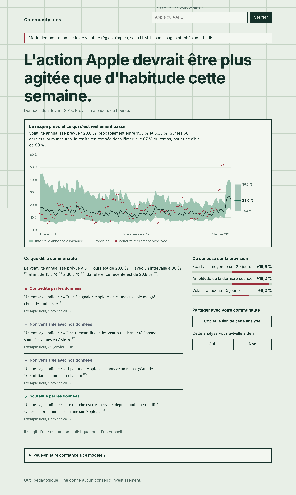
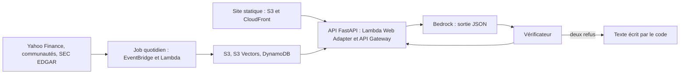

# CommunityLens

Assistant de vérification pour communautés d'investisseurs particuliers. Pour un titre, il prévoit le risque à 5 jours de bourse avec un intervalle mesuré, puis confronte ce que dit la communauté aux données. Outil pédagogique : il ne donne aucun conseil d'investissement.

Projet annuel 4IABD, thème « Communauté ».



## Lancer la démo en 3 commandes

Python 3.11 ou plus. Aucun compte AWS n'est nécessaire.

```bash
pip install -e ".[dev,ui]"
make demo    # télécharge le jeu public de prix et prépare les données
make run     # site et API sur http://localhost:8000
```

Cette démo utilise de vrais prix (jusqu'au 7 février 2018), mais des **messages fictifs** et un **mode sans LLM à règles simples**. L'interface l'indique par un bandeau. Pour un vrai LLM en local : `ollama pull mistral`, puis `CL_LLM_BACKEND=ollama make run`.

Avec Docker : `make demo`, puis `docker compose up --build`. Streamlit est alors sur le port 8501.

## Architecture



Le code calcule tous les chiffres. Le LLM lit et formule. Le vérificateur contrôle chaque sortie.

Le déploiement suit deux étapes : Docker sur EC2, puis serverless. Voir [le guide de déploiement](docs/runbook.md) et [les décisions d'architecture](docs/adr/).

## Résultats mesurés

Walk-forward sur les 30 titres du Dow Jones de février 2018, 20 054 prévisions hors échantillon entre mai 2015 et février 2018, embargo de 5 jours. Détail : [`results/forecast_eval.json`](results/forecast_eval.json). Pour reproduire : `make evaluate`.

| Modèle de volatilité à 5 jours | MAE (log) | QLIKE | R² face à la moyenne historique |
| --- | --- | --- | --- |
| Ridge (retenu) | 0,424 | 0,897 | 0,144 |
| XGBoost | 0,427 | 0,920 | 0,133 |
| HAR | 0,436 | 0,925 | 0,097 |
| Moyenne historique | 0,463 | 0,941 | 0,000 |
| Volatilité sur 20 jours reconduite | 0,485 | 0,929 | -0,127 |

| Intervalle adaptatif | Cible | Couverture réelle |
| --- | --- | --- |
| Niveau 80 % | 80,0 % | 79,7 % |
| Niveau 90 % | 90,0 % | 89,6 % |

**Prédire la direction ne marche pas ici :** XGBoost obtient 50,6 % de réussite et une AUC de 0,504, contre 51,7 % en répondant toujours « hausse ».

## État du projet

| Élément | État |
| --- | --- |
| Modèle, intervalles, évaluation | Exécutés sur données réelles |
| API, site, RAG, vérificateur, stockage | Testés : 111 tests, 94 % de couverture |
| S3 et DynamoDB | Testés sur le simulateur moto |
| Bedrock, S3 Vectors | Requêtes validées contre le modèle d'API de boto3, jamais appelés réellement |
| Terraform, images Docker | Écrits, jamais appliqués ni construits : `terraform validate` et `docker build` tourneront en CI |
| Yahoo Finance, Hacker News, EDGAR, Reddit | Adaptateurs testés sur des réponses simulées, jamais appelés réellement |
| Qualité du LLM réel, injections sur un vrai modèle | **À mesurer** avec `llm_eval` et `injection_eval --mode configured` |

## Qualité

```bash
make lint   # black, pylint, bandit
make test   # pytest avec couverture minimale de 80 %
```

`forecast_eval.py` est exclu de la couverture : il est vérifié par son exécution sur données réelles.

## Structure

```text
src/communitylens/
  domain/        contrats de données
  forecasting/   features, modèle, intervalles, pipeline
  ingestion/     prix, communautés, EDGAR
  rag/           découpage, embeddings, index, retrieval
  llm/           clients, prompts, explication, vérificateur
  storage/       S3, disque, DynamoDB
  api/           routes FastAPI
  jobs/          traitement quotidien
  evaluation/    métriques, walk-forward, injections, benchmark
frontend/        site statique
streamlit_app/   prototype Streamlit
infra/terraform/ infrastructure
evaluation_data/ messages de démo, attaques, exemples annotés
results/         résultats mesurés
docs/            décisions, déploiement, plan d'équipe
```

## Attributions

Voir [ATTRIBUTIONS.md](ATTRIBUTIONS.md).
